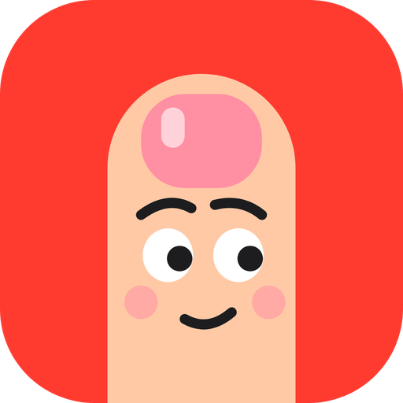

<p align="center"></p>

<h1 align="center">Dedo-Duro</h1>

<p align="center">
  <a href="https://github.com/thalleslopes-dev/dedo-duro/actions/workflows/ci.yml"></a>
  <a href="LICENSE"></a>
  
  
  <a href="https://github.com/astral-sh/ruff"></a>
  
</p>

**Ele te dedura toda vez que o dedo vai pra boca.**

Um app leve para Windows que usa a webcam como sensor para te ajudar a parar de roer unha. Quando sua mão chega perto da boca, ele avisa na hora, com um banner discreto, e se você insistir, com um alerta em tela cheia.

Tudo roda **100% local**. Nenhuma imagem é salva e nada é enviado para a internet.

---

## Por que existe

Roer unha costuma ser automático: você só percebe quando já está roendo. O tratamento com mais evidência para esse tipo de hábito (*habit reversal training*) começa por **perceber o gesto na hora** e **entender o que o dispara**. O Dedo-Duro cuida dessas duas partes enquanto você trabalha.

## Como funciona

```
webcam (3 quadros/s) → MediaPipe (local) → pontos da mão e da boca → distância → alerta
                         imagem descartada na hora
```

1. A cada ~0,3 s, o app pega um quadro da câmera, só na memória.
2. O [MediaPipe](https://ai.google.dev/edge/mediapipe) encontra a boca e os 21 pontos da mão.
3. Se a ponta de um dedo fica perto da boca por cerca de 0,7 s, ele dispara o alerta.
4. O quadro é descartado. No disco ficam só a data, a hora e o nome do app em foco de cada alerta.

Analisar só 3 quadros por segundo mantém o uso de CPU baixo e não atrapalha o trabalho.

## Recursos

- **Alerta progressivo:** na 1ª vez, um banner discreto no canto com um "ding" baixo. Se você repetir em menos de 2 minutos, a tela escurece e aparece um alerta central estilo Apple.
- **Contador no alerta:** "5ª vez hoje", para você ter noção real do hábito.
- **Pausa automática em reuniões:** quando Teams, Meet, Zoom ou Slack usam o microfone ou a câmera, o app libera a webcam e volta sozinho depois.
- **Resumo dos gatilhos:** hoje vs. ontem, recorde de tempo sem alerta, gráficos por hora e por dia, e em quais apps acontece mais (por exemplo, *"39% dos alertas foram no Slack, pico entre 15h e 17h"*).
- **Fica na bandeja do Windows** e **executa quando o computador liga** (opção marcada por padrão, dá para desmarcar).
- **IA treinável:** a regra de distância já funciona de primeira. Se quiser menos alarmes falsos (mão no queixo, beber água), você treina um classificador próprio com seus exemplos em cerca de 2 minutos.

## Privacidade

| O que acontece | Detalhe |
|---|---|
| Imagens | Ficam só na RAM e são descartadas a cada quadro. Nunca vão para o disco. |
| Internet | Usada uma única vez, na 1ª execução, para baixar os modelos. Depois funciona offline. |
| O que é salvo | Data, hora e nome do app em foco de cada alerta. Nunca o título da janela. |
| Treino da IA | Salva só coordenadas da mão em relação à boca (42 números por exemplo). Não dá para reconstruir o rosto. |
| Onde | Tudo em `%LOCALAPPDATA%\DedoDuro`, fora da pasta do código. |

## Como rodar

### Você vai precisar de

- Windows 10 ou 11
- Uma webcam
- Python 3.10 ou mais novo (o passo 1 explica como instalar)

### Passo a passo

**1. Instale o Python** (pule se `python --version` já funciona no terminal)

Abra o PowerShell e rode:

```powershell
winget install Python.Python.3.13
```

Ou baixe em [python.org/downloads](https://www.python.org/downloads/). Na primeira tela do instalador, **marque "Add python.exe to PATH"**. Depois feche e abra o terminal de novo e confira:

```powershell
python --version
```

**2. Baixe o projeto**

Com git:

```powershell
git clone https://github.com/thalleslopes-dev/dedo-duro.git
cd dedo-duro
```

Sem git: na página do repositório, clique em **Code → Download ZIP** e extraia. Abra a pasta extraída, clique com o botão direito num espaço vazio e escolha **Abrir no Terminal**.

**3. Instale as dependências** (só na primeira vez, leva alguns minutos)

```powershell
python -m venv .venv
.venv\Scripts\python -m pip install -e .
```

Isso cria um ambiente isolado na pasta `.venv`, sem mexer no resto do seu Python.

**4. Abra o app**

Dê duplo clique em **`iniciar.bat`**, ou rode:

```powershell
.venv\Scripts\dedo-duro.exe
```

Na primeira vez, o app baixa os modelos de IA (~10 MB). Em seguida o mascote aparece na barra de tarefas e perto do relógio (talvez escondido na setinha **^**).

**5. Teste**

Clique com o botão direito no mascote perto do relógio e escolha **Testar alerta**. Depois, leve a mão à boca na frente da câmera: em cerca de 1 segundo, o alerta aparece.

### Das próximas vezes

Não precisa fazer nada: a opção **Executar quando o computador ligar** vem marcada, e o app abre sozinho, minimizado, em segundo plano, toda vez que o PC liga.
Para desligar, desmarque o checkbox na janela do app (clique no mascote na barra de tarefas) ou no menu do mascote perto do relógio. Para abrir manualmente, dê duplo clique em `iniciar.bat`.

### Problemas comuns

| Problema | Solução |
|---|---|
| `python` não é reconhecido | Reinstale o Python marcando **Add python.exe to PATH**, ou troque `python` por `py` nos comandos. |
| O mascote fica com bolinha laranja ("Câmera ocupada") | Outro app está usando a webcam. Feche-o, e o Dedo-Duro volta sozinho. |
| A câmera não liga | Em **Configurações → Privacidade e segurança → Câmera**, ative **Permitir que aplicativos da área de trabalho acessem a câmera**. |
| Nada acontece ao abrir | Veja o log em `%LOCALAPPDATA%\DedoDuro\logs\dedo-duro.log` (cole esse caminho na barra do Explorador). |
| Alarme falso (mão no queixo, bebendo água) | Ajuste a sensibilidade (veja **Calibrar**, abaixo) ou treine o modelo pessoal. |
| "O app já está rodando" | Ele já está aberto: procure o mascote perto do relógio. |

### Atualizar e desinstalar

- **Atualizar:** `git pull` e depois `.venv\Scripts\python -m pip install -e .`
- **Desinstalar:**
  1. desmarque **Executar quando o computador ligar**;
  2. clique em **Sair**;
  3. apague a pasta do projeto;
  4. apague `%LOCALAPPDATA%\DedoDuro`, que guarda seus dados e os modelos.

## Uso

Rode **`.venv\Scripts\dedo-duro.exe`** (ou dê duplo clique em `iniciar.bat`). O mascote aparece na barra de tarefas e perto do relógio:

- Mascote normal: vigiando · com bolinha laranja: pausado por chamada · cinza: pausado por você
- **Barra de tarefas:** clique para ver o status, abrir o resumo, pausar ou sair
- **Bandeja, clique direito:** Ver resumo, Pausar, Testar alerta, Executar quando o computador ligar, Sair
- **Executar quando o computador ligar:** checkbox na janela e no menu; marcado por padrão
- **Bandeja, duplo clique:** abre o resumo

### Calibrar

```powershell
.venv\Scripts\python -m dedo_duro --preview
```

Abre uma janela com os pontos detectados e a distância entre o dedo e a boca. O alerta dispara abaixo de `0.25`. Ajuste com `--limite`.

### Opções

| Opção | Efeito |
|---|---|
| `--preview` | mostra a câmera com os pontos |
| `--limite 0.35` | mais sensível (padrão `0.25`) |
| `--duracao 8` | segundos do alerta em tela cheia (padrão `5`) |
| `--repeticao 300` | janela, em segundos, para o alerta virar tela cheia (padrão `120`) |
| `--sempre-tela-cheia` | desliga o alerta discreto |
| `--sem-pausa-reuniao` | não pausa durante chamadas |
| `--sem-modelo` | ignora o modelo pessoal e usa a regra de distância |
| `--testar-alerta` | dispara um alerta ao abrir |

### Treinar sua IA (opcional)

```powershell
.venv\Scripts\python -m dedo_duro coletar roendo   # 60 s simulando roer a unha (varie mão, dedo e ângulo)
.venv\Scripts\python -m dedo_duro coletar normal   # 60 s trabalhando: digitar, mão no queixo, beber água
.venv\Scripts\python -m dedo_duro treinar
```

O app passa a usar o modelo pessoal (um Random Forest do scikit-learn) na próxima vez que abrir.

### Onde ficam os dados

```
%LOCALAPPDATA%\DedoDuro\
├── historico.csv        data, hora, app em foco e tipo de cada alerta
├── recorde.json         maior tempo sem alerta do dia
├── treino\              exemplos coletados e modelo pessoal
├── modelos\             modelos do MediaPipe (baixados na 1ª execução)
├── sons\                sons dos alertas (troque por qualquer .wav com o mesmo nome)
└── logs\dedo-duro.log   o que aconteceu, inclusive erros
```

## Arquitetura

```
webcam ─► Camera ─► Detector (MediaPipe) ─► geometria ─► Decisor ─► Monitor ─► alerta + histórico
                                             (puro)    regra/modelo  (regras de
                                                                      quando alertar)
```

```
src/dedo_duro/
├── cli.py               linha de comando (app, coletar, treinar)
├── app.py               orquestração: liga as peças, sem regra própria
├── config.py            parâmetros e caminhos (%LOCALAPPDATA%)
├── monitor.py           quando e como alertar (progressivo, espera, recorde)
├── log.py               log em arquivo
├── deteccao/            câmera, MediaPipe, geometria, decisor, download dos modelos
├── dados/               histórico, recorde e cálculos do resumo
├── sistema/             Windows: app em foco, chamadas, atalhos
├── ui/                  tema, alertas, janela, resumo, bandeja, sons, textos
├── treino/              coletar exemplos e treinar o modelo pessoal
└── recursos/            logo e ícone
tests/                   testes da lógica (sem câmera e sem interface)
```

O `monitor`, a `geometria`, o `dados/` e o `decisor` não dependem de câmera nem de interface. Por isso dá para testar tudo isso sem hardware.

## Desenvolvimento

```powershell
.venv\Scripts\python -m pip install -e ".[dev]"
.venv\Scripts\ruff check src tests
.venv\Scripts\pytest
```

O CI (GitHub Actions) roda o lint e os testes no Windows, com Python 3.11, 3.12 e 3.13, a cada push e pull request.

## Limitações conhecidas

- **Só Windows**, porque usa APIs do sistema para a bandeja, o app em foco e a detecção de chamadas.
- **A webcam fica ocupada enquanto o app vigia.** Se uma reunião tentar ligar a câmera antes do microfone, desligue e ligue a câmera nela depois de uns 3 s.
- **A regra de distância** pode disparar com a mão no queixo. Treinar o modelo pessoal reduz isso.

## Licença

[MIT](LICENSE): gratuito e livre. Você pode usar, copiar, modificar, distribuir e até vender, para qualquer fim, desde que mantenha o aviso de copyright e o texto da licença. O software é fornecido "como está", sem garantia.

## Créditos

- [MediaPipe](https://ai.google.dev/edge/mediapipe), detecção de mão e rosto (Apache 2.0)
- [Tabler Icons](https://tabler.io/icons), ícones (MIT)
- Inspirado por projetos como [HabitKicker](https://github.com/ExxML/HabitKicker), [nomo_nailbiting](https://github.com/alecsharpie/nomo_nailbiting) e [Calm Hands](https://williamthyer.github.io/posts/2023/3/calm-hands)

---

*O Dedo-Duro não substitui acompanhamento profissional. Se roer unha estiver causando machucados ou sofrimento, procure um dermatologista ou psicólogo.*
